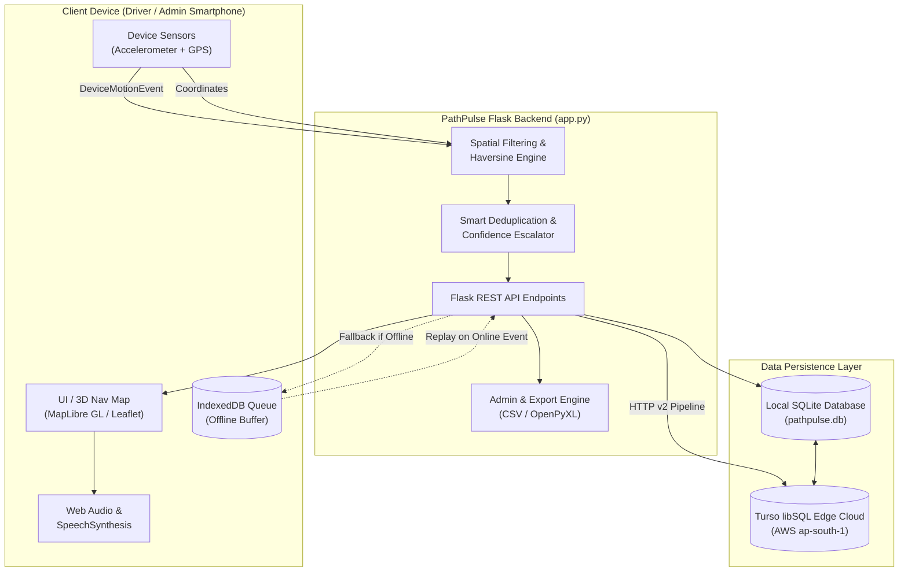

# 🛣️ PathPulse AI — Comprehensive Project Documentation & LLM Knowledge Base

> **Note for ChatGPT / AI Assistant:**  
> This document contains the complete, authoritative specification of **PathPulse AI**. It covers the system architecture, mathematical formulas, hardware and software requirements, database schemas, full REST API endpoints, edge cloud replication, sensor telemetry workflows, algorithms, and directory structure. Use this context to understand, analyze, debug, extend, or generate code and documentation for the project.

---

## 📌 Executive Summary

**PathPulse AI** is an intelligent, real-time road condition monitoring, pothole detection, and dynamic 3D vehicular navigation system. It transforms standard smartphones into road-scanning telemetry units using native web browser APIs (`DeviceMotionEvent` for 3-axis accelerometer data and `Geolocation API` for GPS coordinates).

### Primary Objectives:
1. **Automated Pothole Detection:** Detect road bumps and pothole impacts automatically using physical acceleration analysis without requiring specialized automotive hardware.
2. **Spatial Deduplication & Multi-Report Confidence:** Distinguish multiple hits on the same physical pothole (< 3.0 m GPS radius) from consecutive distinct potholes (even 5m–15m apart), increasing confidence and severity dynamically.
3. **Pothole-Aware 3D Turn-by-Turn Navigation:** Guide drivers with camera tilt (58°), forward-heading bearing, audio cues, and voice warnings 50 meters before known road hazards.
4. **Municipal Data Export & Administration:** Allow road authorities to inspect, edit, resolve, and export road defect datasets into government-ready CSV and formatted Excel (`.xlsx`) files.
5. **Hybrid Cloud-Edge Synchronization:** Provide zero-downtime persistence across local SQLite databases and remote Turso (libSQL) Edge cloud database over HTTP pipeline APIs, with full serverless compatibility (Vercel).

---

## 🖥️ System Requirements

### 1. Hardware Requirements

#### A. Client-Side / Field Detection Device (Smartphone / Vehicle)
| Component | Minimum Specification | Recommended Specification | Purpose |
| :--- | :--- | :--- | :--- |
| **Device Type** | Any modern Android or iOS smartphone | Smartphone with high refresh rate & fast GNSS | Field sensor telemetry & navigation |
| **Motion Sensors** | 3-Axis Accelerometer (IMU) capable of $\ge 20 \text{ Hz}$ sampling | 3-Axis Accelerometer + Gyroscope ($\ge 50 \text{ Hz}$) | Vertical impact & vibration detection |
| **GPS / GNSS** | Standard A-GPS receiver ($< 10 \text{ m}$ accuracy) | Dual-frequency GPS / GLONASS / Galileo ($< 3 \text{ m}$ accuracy) | Accurate geotagging of road defects |
| **Audio Output** | Built-in speaker | Car Bluetooth audio / stereo connection | Voice alerts ("Caution, pothole ahead") & synth warning beeps |
| **Vehicle Mount** | Rigid dashboard or AC vent phone cradle | Solid mechanical cradle attached directly to windshield or dash | Prevents loose phone vibrations from causing false positives |
| **Power / Battery** | 3000 mAh internal battery | Continuous 12V/USB vehicular charger plugged in | Prevents battery drain from continuous GPS & screen usage |
| **Screen Display** | 720p LCD touchscreen | 1080p OLED / AMOLED display with high sunlight brightness | Real-time map navigation and telemetry display |

#### B. Development & Server-Side Host
| Component | Minimum Specification | Recommended Specification |
| :--- | :--- | :--- |
| **Processor (CPU)** | Dual-Core 2.0 GHz (x86_64 or ARM64) | Quad-Core 2.5 GHz+ (Intel Core i5 / AMD Ryzen 5 / Apple M-series) |
| **System Memory (RAM)** | 2 GB RAM | 4 GB to 8 GB RAM |
| **Disk Storage** | 2 GB available storage | 10 GB SSD storage |
| **Network Interface** | 5 Mbps broadband or 4G LTE | 25+ Mbps high-speed internet connection (HTTPS, WSS, API calls) |

---

### 2. Software Requirements

#### A. Runtime & Programming Languages
* **Python Runtime:** Python **3.8.x** or higher (tested with Python 3.10, 3.11, 3.12).
* **Frontend Runtime:** Modern ECMAScript (ES6+) with native Web APIs.
* **Operating Systems:**
  * **Development / Hosting:** Windows 10/11, Ubuntu 20.04+, Debian, macOS 12+, Vercel Serverless Linux.
  * **Client Browsers:** Google Chrome (v90+), Mozilla Firefox (v90+), Safari iOS (v14+ with Motion permission), Brave, Microsoft Edge.

#### B. Python Libraries & Dependencies (`requirements.txt`)
* `Flask==3.0.3`: Core WSGI web application server and REST API framework.
* `Flask-SQLAlchemy==3.1.1`: Object-Relational Mapping (ORM) layer.
* `Flask-CORS==4.0.0`: Cross-Origin Resource Sharing handling for decoupled clients.
* `gunicorn==22.0.0`: Production WSGI HTTP server for Linux environments.
* `openpyxl>=3.1.0`: Generation of formatted Excel spreadsheets (`.xlsx`) with styling, borders, and auto-filters.
* `psycopg2-binary>=2.9.9`: PostgreSQL database adapter (for production deployments).
* `sqlalchemy-libsql>=0.1.0`: Native Turso libSQL dialect support.
* `requests>=2.28.0`: HTTP client for external service integration.

#### C. Frontend Libraries & External CDN Services
* **MapLibre GL JS (`v4.7.1`):** WebGL-powered 3D vector map rendering, camera pitch, and dynamic bearing rotation.
* **Leaflet.js (`v1.9.4`):** Interactive mapping engine for 2D overview maps.
* **Leaflet Routing Machine (`v3.2.12`):** Turn-by-turn route calculation and waypointing.
* **Chart.js (`v4.x`):** Dynamic real-time accelerometer waveform charts and admin statistical dashboards.
* **Komoot Photon API (`photon.komoot.io`):** Geocoding and destination search based on OpenStreetMap.
* **OSRM (Open Source Routing Machine):** Road geometry routing calculations.
* **Web Audio API & Web Speech API (`SpeechSynthesis`):** Synthesized tone beeps and spoken turn-by-turn instructions.

---

## 🏗️ Architecture & Technical Design

### High-Level Architectural Flow


---

## 🧮 Mathematical Formulations & Detection Logic

### 1. Accelerometer Physics & Impact Detection
Mobile devices provide instantaneous linear acceleration measurements across three spatial axes:
* $a_x$: Lateral acceleration (swaying / turning)
* $a_y$: Longitudinal acceleration (braking / speeding)
* $a_z$: Vertical acceleration (perpendicular to road surface)

The total instantaneous acceleration magnitude is:
$$\text{Magnitude} = \sqrt{a_x^2 + a_y^2 + a_z^2}$$

To isolate road shock from standard Earth gravitational acceleration ($g \approx 9.81 \text{ m/s}^2$), the deviation is calculated:
$$\Delta a = |\text{Magnitude} - 9.81|$$

#### Severity Threshold Classification:
* **Low Impact:** $\Delta a < 15.0 \text{ m/s}^2$ (minor cracks, surface roughness, shallow expansion joints)
* **Medium Impact:** $15.0 \text{ m/s}^2 \le \Delta a < 25.0 \text{ m/s}^2$ (noticeable potholes, sunken manholes)
* **High Impact (Critical):** $\Delta a \ge 25.0 \text{ m/s}^2$ (severe wheel-damaging craters, structural road failures)

---

### 2. Precise Spatial Deduplication & Separate Pothole Storage

To avoid duplicate database entries from multiple vehicles hitting the same pothole while correctly preserving adjacent distinct potholes:

#### Haversine Great-Circle Distance:
Given two coordinate pairs $(\text{lat}_1, \text{lon}_1)$ and $(\text{lat}_2, \text{lon}_2)$:
$$\Delta \phi = \text{radians}(\text{lat}_2 - \text{lat}_1), \quad \Delta \lambda = \text{radians}(\text{lon}_2 - \text{lon}_1)$$
$$a = \sin^2\left(\frac{\Delta \phi}{2}\right) + \cos(\phi_1) \cdot \cos(\phi_2) \cdot \sin^2\left(\frac{\Delta \lambda}{2}\right)$$
$$c = 2 \cdot \text{atan2}(\sqrt{a}, \sqrt{1 - a})$$
$$d = R \cdot c \quad \text{where } R = 6,371,000 \text{ meters}$$

#### Deduplication Rules:
1. **Candidate Retrieval:** Queries existing active potholes within a bounding box ($\pm 0.0005^{\circ} \approx 50 \text{ m}$).
2. **Same Physical Pothole ($d < 3.0 \text{ meters}$):**
   * Identified as GPS jitter/repeat hit on the same defect.
   * Increments `report_count += 1`.
   * Scales confidence: $\text{confidence} = \min(1.0, \text{confidence} + 0.1)$.
   * Updates `accel_peak = \max(\text{existing}, \text{new})`.
   * Upgrades severity:
     * If `report_count >= 10` $\rightarrow$ upgrades to `high`.
     * If `report_count >= 5` and severity is `low` $\rightarrow$ upgrades to `medium`.
     * If newly recorded peak exceeds previous threshold $\rightarrow$ updates to higher severity level.
3. **Distinct Physical Potholes ($d \ge 3.0 \text{ meters}$):**
   * Potholes separated by 5m, 8m, 15m, or 20m are **always stored as independent database records**.

---

### 3. Dynamic Heading & 3D Camera Bearing
To deliver a car-dashboard experience matching modern navigation apps:
$$\theta = \text{atan2}\left(\sin(\Delta \lambda) \cdot \cos(\phi_2), \; \cos(\phi_1) \cdot \sin(\phi_2) - \sin(\phi_1) \cdot \cos(\phi_2) \cdot \cos(\Delta \lambda)\right)$$
$$\text{Bearing} = (\text{degrees}(\theta) + 360) \pmod{360}$$

* **3D Perspective Tilt:** Map camera is locked at a **$58^\circ$ pitch**.
* **Course-Up Mode:** Map automatically aligns the driving direction upward along the computed bearing.
* **Hazard Proximity Alert:** When distance to any active pothole along the route drops under **$50 \text{ meters}$**, the system triggers a voice alert and visual warning banner.

---

## 🗄️ Database Schema & Models

### SQLAlchemy Model: `Pathole`

| Column | Type | Constraints | Default | Description |
| :--- | :--- | :--- | :--- | :--- |
| `id` | `INTEGER` | Primary Key, Auto-increment | — | Unique identifier |
| `latitude` | `FLOAT` | `nullable=False` | — | WGS84 Latitude coordinate |
| `longitude` | `FLOAT` | `nullable=False` | — | WGS84 Longitude coordinate |
| `severity` | `VARCHAR(20)` | `nullable=False` | `'medium'` | Severity level: `low`, `medium`, `high` |
| `confidence` | `FLOAT` | `nullable=False` | `0.5` | Confidence metric ($0.0 \le c \le 1.0$) |
| `reported_by` | `VARCHAR(100)`| `nullable=True` | `'Admin'` | Identity of reporter |
| `report_count`| `INTEGER` | `nullable=False` | `1` | Cumulative confirmed hits |
| `accel_peak` | `FLOAT` | `nullable=True` | `None` | Max recorded acceleration spike ($\text{m/s}^2$) |
| `created_at` | `DATETIME` | UTC Timestamp | `now()` | Initial detection timestamp |
| `updated_at` | `DATETIME` | UTC Timestamp | `now()` | Latest detection/edit timestamp |
| `is_active` | `BOOLEAN` | `nullable=False` | `True` | Active status (`True` = Hazard, `False` = Resolved) |

---

## 📡 REST API Specification

### 1. Public & Navigation APIs

#### `GET /api/patholes`
Retrieves potholes with optional spatial bounding box and status filtering.
* **Query Parameters:**
  * `lat_min`, `lat_max`, `lng_min`, `lng_max` *(float, optional)*: Geographic bounding box.
  * `status` *(string, default: `active`)*: Options: `active`, `resolved`, `all`.
* **Response (200 OK):**
```json
{
  "status": "success",
  "count": 1,
  "patholes": [
    {
      "id": 1,
      "latitude": 12.971599,
      "longitude": 77.594566,
      "severity": "high",
      "confidence": 0.8,
      "reported_by": "Admin",
      "report_count": 3,
      "accel_peak": 26.8,
      "created_at": "2026-10-12T13:00:00+00:00",
      "updated_at": "2026-10-12T13:05:00+00:00",
      "is_active": true
    }
  ]
}
```

#### `GET /api/stats`
Retrieves analytical metrics and 7-day timeline trends.
* **Response (200 OK):**
```json
{
  "status": "success",
  "stats": {
    "total_reported": 45,
    "unique_patholes": 38,
    "active_patholes": 32,
    "resolved": 6,
    "high_severity": 11,
    "severity_distribution": {
      "low": 12,
      "medium": 9,
      "high": 11
    },
    "weekly_timeline": {
      "labels": ["Mon", "Tue", "Wed", "Thu", "Fri", "Sat", "Sun"],
      "data": [4, 7, 3, 8, 12, 6, 5]
    }
  }
}
```

---

### 2. Admin & Telemetry APIs (Protected)

#### `POST /api/admin/login`
Authenticates administrative users and creates an encrypted server session.
* **Payload:** `{"username": "admin@example.com", "password": "password"}`
* **Response (200 OK):** `{"status": "success", "message": "Logged in successfully"}`

#### `POST /api/admin/logout`
Terminates administrative session.

#### `GET /api/admin/check`
Returns session status: `{"logged_in": true}`.

#### `POST /api/patholes`
Records a newly detected pothole or updates an existing physical pothole within $< 3.0 \text{ m}$.
* **Authorization:** Requires active Admin session.
* **Payload:**
```json
{
  "latitude": 12.971599,
  "longitude": 77.594566,
  "accel_peak": 22.4,
  "severity": "medium",
  "confidence": 0.7
}
```
* **Response (201 Created or 200 OK):**
```json
{
  "status": "success",
  "message": "New pathole reported",
  "duplicate": false,
  "pathole": { ... }
}
```

#### `POST /api/patholes/<id>/resolve`
Marks a pothole as resolved/repaired (soft-deletes from live road maps).

#### `POST / PUT /api/patholes/<id>/edit`
Modifies latitude, longitude, severity, confidence, or active state.

#### `DELETE / POST /api/patholes/<id>/delete`
Permanently deletes a pothole record from local and Turso Edge cloud databases.

#### `POST / DELETE /api/patholes/clear-all`
Purges all pothole records from local SQLite and remote Turso cloud (Admin reset).

---

### 3. Data Export Endpoints

#### `GET /admin/export/csv?status=all`
Generates and downloads a standardized municipal road maintenance CSV report.
* **Headers:** `Pothole ID, Latitude, Longitude, Severity, Confidence, Detection Date, Detection Time, Report Count, Accelerometer Peak (m/s²), Verification Status, Reported By`.

#### `GET /admin/export/excel?status=all`
Generates a styled, branded Excel workbook (`.xlsx`) using `openpyxl`:
* Emerald header banner styling (`#064E3B`)
* Formatted coordinate columns (`0.000000`)
* Auto-filter enabled on column headers
* Frozen header panes at Row 3

---

## 🗂️ Project Directory Structure

```text
PathPulse_AI-main/
│
├── app.py                      # Flask backend, Turso sync, REST API, & ORM models
├── requirements.txt            # Python dependencies (Flask, SQLAlchemy, openpyxl, etc.)
├── requirements_utf8.txt       # UTF-8 encoded complete dependency requirements
├── pathpulse.db                # Local SQLite persistence database
├── test_deduplication.py       # Unit test suite verifying spatial deduplication
├── vercel.json                 # Vercel serverless deployment routing & static assets
├── manifest.json               # Progressive Web App (PWA) manifest configuration
├── service-worker.js           # PWA offline cache and background network interceptor
│
├── api/
│   └── index.py                # WSGI entrypoint adapter for Vercel serverless functions
│
├── templates/
│   ├── index.html              # Main public overview dashboard & statistics
│   ├── map.html                # Fullscreen 3D live navigation & hazard map
│   ├── detect.html             # Sensor acquisition ride engine (Admin only)
│   └── admin.html              # Municipal management portal, table, charts & exports
│
└── static/
    ├── css/
    │   └── style.css           # Global design system, glassmorphism, responsive layout
    ├── icons/
    │   ├── icon-192.png        # PWA 192x192 application icon
    │   └── icon-512.png        # PWA 512x512 application icon
    └── js/
        ├── dashboard.js        # Overview metrics & real-time counters loader
        ├── detect.js           # Accelerometer sensor capture, GPS logger & offline queue
        ├── map.js              # MapLibre GL map engine, marker clustering & filters
        ├── navigation.js       # 3D navigation module, 58° pitch tilt, OSRM & voice audio
        └── pwa-install.js      # PWA browser install prompt prompt handler
```

---

## 🚀 Setup & Execution Guide

### 1. Local Environment Setup

1. **Clone the repository:**
   ```bash
   git clone https://github.com/basavaraj-08-28/PathPulse_AI-main.git
   cd PathPulse_AI-main
   ```

2. **Create a Python Virtual Environment:**
   * **Windows (PowerShell):**
     ```powershell
     python -m venv venv
     .\venv\Scripts\Activate.ps1
     ```
   * **Linux / macOS:**
     ```bash
     python3 -m venv venv
     source venv/bin/activate
     ```

3. **Install Dependencies:**
   ```bash
   pip install -r requirements.txt
   ```

4. **Configure Environment Variables (Optional):**
   ```bash
   # Optional overrides for Admin credentials and database
   export ADMIN_USER="basavarajyn123@gmail.com"
   export ADMIN_PASSWORD="your_secure_password"
   export SECRET_KEY="custom-session-key"
   ```

5. **Start Local Development Server:**
   ```bash
   python app.py
   ```
   The application will boot at `http://127.0.0.1:5000`.

---

### 2. Running Automated Unit Tests
To verify the Haversine distance engine and spatial deduplication logic:
```bash
python test_deduplication.py
```
**Test Scenarios Covered:**
* ✅ Accuracy of Haversine distance formula calculation.
* ✅ Storing two potholes 8 meters apart as distinct database records.
* ✅ Incrementing `report_count` when detections occur within $< 3.0 \text{ m}$.
* ✅ Handling 3 consecutive potholes spaced 8m and 5m apart.
* ✅ Spatial edge cases at 5m, 15m, and 25m offsets.
* ✅ Multi-user convergence on a single physical pothole defect.

---

### 3. Desktop Simulation Mode
When testing on a laptop or desktop without physical accelerometer sensors:
1. Navigate to `/detect` (after logging into `/admin`).
2. The client will detect the lack of `DeviceMotionEvent` hardware.
3. It automatically engages **Desktop Simulation Mode**, generating realistic road noise ($9.81 \pm 1.5 \text{ m/s}^2$) with a 5% stochastic probability of triggering localized pothole spikes.

---

## 🔒 Security & Deployment Architecture

1. **Role-Based Access Control (RBAC):**
   * Detection telemetry logging (`/detect`), manual reporting, pothole resolution, deletion, and dataset exports are strictly restricted to authenticated admin sessions.
2. **Serverless Filesystem Adaptation:**
   * When deployed on Vercel or AWS Lambda, the application detects read-only filesystems and dynamically relocates the SQLite scratch database to `/tmp/pathpulse.db`, automatically synchronizing mutations with the **Turso libSQL Edge Cloud**.
3. **PWA Offline Resilience:**
   * Accelerometer hits logged during cellular dropouts are persisted in client **IndexedDB** (`PathPulseOffline`) and replayed automatically via exponential backoff upon network restoration.
